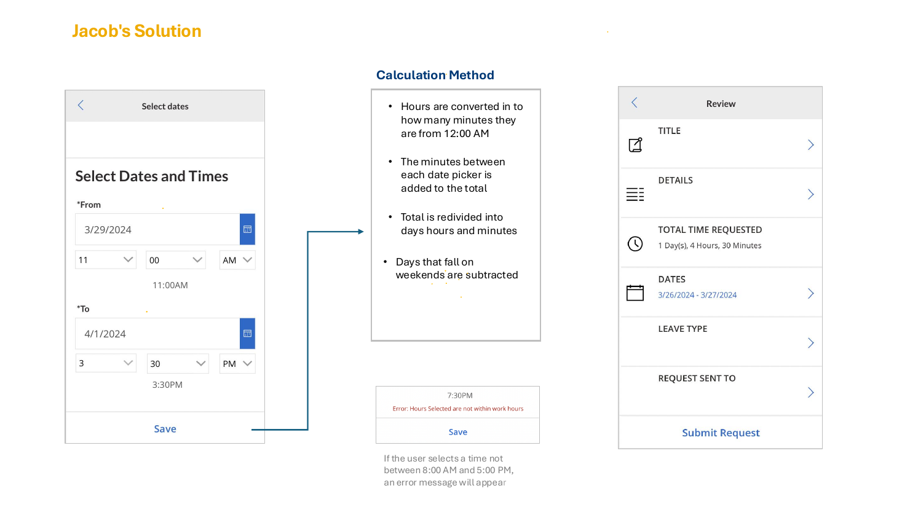
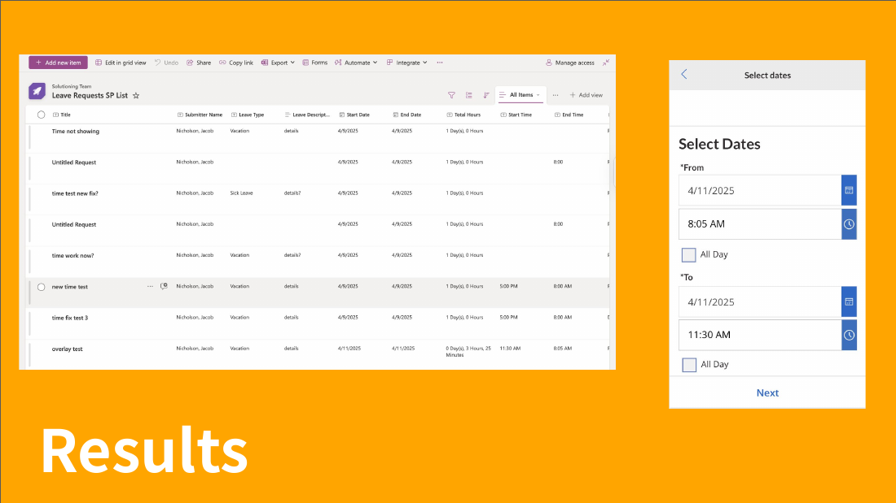
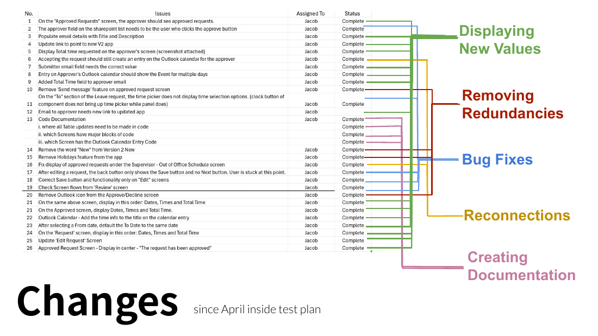

# Leave Request App: Time Calculation

How I designed and built the work-time calculation for Kent State's **Leave Request App**, a Power Apps tool employees use to request time off, plus the same logic rewritten in TypeScript with automated tests.

I worked on this app on Kent State's Digital Leadership Academy (DLA) Solutioning Team from January 2024 through fall 2025.

## The problem

The original app had two big limitations:

- **Employees could only request whole days.** The date selector had no times, so a morning appointment counted as a full day off.
- **Data lived in an Excel sheet.** It was hard to navigate, and old records had to be purged regularly or the app wouldn't load.

## Process

**1. Parallel prototypes.** Three of us (Halie, Caitlyn and I) each built our own version of time selection, partial-day calculation and a review screen. We then reviewed each other's code and UI, wrote test cases together, and combined the best ideas.



**2. Final solution.** The shipped app combined my calculation logic and error messages, Caitlyn's time picker and navigation fix, Halie's "All Day" checkbox and DateTime conversion, and Caitlyn and Halie's review screen.

**3. Excel → SharePoint.** I moved the app's backend from Excel to a SharePoint list, which supports multiple users, larger data sets and better data integrity. I added new fields (Total Hours, Leave ID), fixed record-update issues, updated the export logic and fixed approver emails.



**4. V2 launch prep.** When a Microsoft update deprecated OneDrive features V1 relied on, I worked through a 26-item test plan: displaying new values, removing redundancies, fixing bugs, reconnecting data sources and writing documentation. I also demoed the app to refine the user journey.



## The calculation rules

- Workday is **8:00 AM to 5:00 PM**, with an unpaid lunch from **12:00 to 1:00 PM**, so 1 day = 8 work hours.
- Times outside work hours show an error: *"Hours selected are not within work hours."*
- "All Day" means 8:00 AM on the first day or 5:00 PM on the last day.
- Weekends are skipped.
- The result is shown as `X Day(s), Y Hours, Z Minutes`.

## What's in this repo

| Folder | Contents |
|---|---|
| [`original/`](original/) | My Power Fx code as it shipped, with notes on what I'd do differently now |
| [`src/`](src/leaveTime.ts) | The same rules rewritten in TypeScript: whole-minute math, day-by-day calculation, named constants |
| [`tests/`](tests/leaveTime.test.ts) | 21 test cases: partial days, lunch, multi-day, weekends, validation |
| [`docs/slides/`](docs/slides/) | Show-and-tell presentations from each stage of the project |

The rewrite is a learning exercise. It applies what I've learned since writing the original, and the test cases cover the edge cases we checked by hand.

```ts
import { calculateLeave, formatDuration } from './src/leaveTime';

const leave = calculateLeave({
  startDate: '2024-03-29', startTime: '11:00', // Friday, 11:00 AM
  endDate: '2024-04-01',   endTime: '15:30',   // Monday, 3:30 PM
});

formatDuration(leave); // "1 Day(s), 3 Hours, 30 Minutes"
```

## Run the tests

Requires Node.js 20+.

```bash
npm install
npm test
```

Tests also run automatically on every push with GitHub Actions.

## Built with

- **Original app:** Microsoft Power Apps (Power Fx), SharePoint, Office 365 Outlook connector
- **Rewrite:** TypeScript, Vitest, GitHub Actions
- **AI-assisted development:** Claude, for the TypeScript rewrite, tests and documentation

---

The original app and code were created at Kent State University. Shared here as portfolio work.
